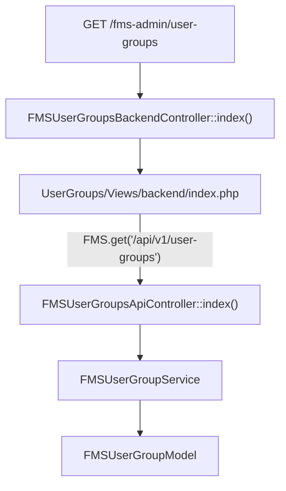

<div align="center">


<h1>FMS CodeIgniter 4 HMVC</h1>

<p><strong>Fondasi aplikasi modular berbasis CodeIgniter 4</strong><br>
Arsitektur API-first, vertical-slice HMVC, dan antarmuka admin FMS.</p>

<p>
  
  
  
  
  
  
</p>

</div>

> [!NOTE]
> **Status fondasi:** HMVC dan API-first sudah aktif. Modul Users, UserGroups, Privileges, AdminMenus, Profile, Brand, dan Activity Logs memakai controller Backend yang hanya merender halaman, dengan browser client memanggil API same-origin. Beberapa integrasi lanjutan masih dalam pengembangan.

---

## Daftar Isi

| Memulai | Arsitektur | Sistem | Operasional |
| --- | --- | --- | --- |
| [Quick Start](#quick-start-setelah-clone) | [Arsitektur](#arsitektur) | [Konvensi Database](#konvensi-database) | [Dokumentasi API dan Bruno](#dokumentasi-api-dan-bruno) |
| [Environment](#variabel-environment-dan-konfigurasi) | [Route](#route) | [Upload Gambar](#upload-gambar) | [Pengujian](#pengujian) |
| [Perintah Modul](#perintah-modul) | [Kontrak Response API](#kontrak-response-api) | [Template dan Aset Admin](#template-dan-aset-admin) | [Status Repository](#status-repository) |
| [Teknologi](#teknologi) | [Autentikasi dan Otorisasi](#autentikasi-dan-otorisasi) | [Halaman Error](#halaman-error) | [Mengganti Remote Origin](#mengganti-remote-origin) |
| | [Standar Penulisan PHP](#standar-penulisan-php) | | [Lisensi](#lisensi) |

---

## Teknologi

| Komponen | Versi / Catatan |
| --- | --- |
| PHP | `^8.4` |
| CodeIgniter | `4.7.6` |
| Composer | Manajemen dependensi |
| MySQL / MariaDB | InnoDB dan `utf8mb4` |
| PHPUnit | `10` |
| Bootstrap | `5` |
| OpenAPI | `3.1` untuk dokumentasi API target |

### Kemampuan inti

| Bidang | Ringkasan |
| --- | --- |
| Modul | Setiap domain berdiri sebagai vertical slice HMVC dengan prefix `FMS` |
| API | Envelope respons terpusat plus signature `Ed25519` |
| Auth | JWT access token, opaque refresh token dengan rotation dan revocation |
| Otorisasi | RBAC deny-by-default, permission per menu, object-level authorization |
| Aset | Pipeline upload bersama: validasi, re-encode WebP, simpan di luar web root |

---

## Arsitektur

Setiap domain ditempatkan dalam satu modul agar sistem tetap mudah dipelihara ketika membesar.

```text
app/Modules/Users/
├── Config/
│   ├── ApiRoutes.php
│   └── BackendRoutes.php
├── Controllers/
│   ├── Api/
│   │   └── FMSUsersApiController.php
│   └── Backend/
│       └── FMSUsersBackendController.php
├── Models/
├── Services/
├── Validation/
└── Views/
    └── backend/
        └── index.php
```

Pola yang sama digunakan oleh modul:

- `Authentication`
- `Users`
- `UserGroups`
- `Brand`
- `AdminMenus`
- `Privileges`
- `Profile`
- `ActivityLogs`
- `Uploads`

### Pembagian tanggung jawab

| Lapisan | Tanggung jawab |
| --- | --- |
| `Controllers/Api` | Menerima request HTTP dan mengembalikan JSON |
| `Controllers/Backend` | Hanya merender shell atau view HTML |
| `Services` | Satu-satunya tempat business rules domain |
| `Models` | Akses database, dan hanya dipakai melalui service |
| `Validation` | Menetapkan kontrak input |
| `Views` | Presentation layer, tidak mengakses database |

### Alur request

Controller Backend tidak memanggil controller API sebagai class dan tidak menggunakan cURL internal. Browser memanggil API same-origin secara langsung melalui `FMS.ajax`:



Backend controller pada modul API-first hanya berisi method `index()` yang memanggil `requireBackendPermission()` lalu `fmsLayout()`. Contohnya:

- `app/Modules/UserGroups/Controllers/Backend/FMSUserGroupsBackendController.php`
- `app/Modules/Privileges/Controllers/Backend/FMSPrivilegesBackendController.php`
- `app/Modules/Users/Controllers/Backend/FMSUsersBackendController.php`

---

## Route

Route dipisahkan per modul:

- `Config/ApiRoutes.php` dimuat satu kali di dalam group `/api/v1`.
- `Config/BackendRoutes.php` dimuat satu kali di dalam group `/fms-admin`.
- Auto-routing harus dinonaktifkan.
- Setiap endpoint harus memiliki HTTP verb, nama route, controller, dan filter yang eksplisit.

| Jenis | Prefix | Isi |
| --- | --- | --- |
| API | `/api/v1` | Operasi resource, JSON |
| Backend | `/fms-admin` | Render halaman saja |

Contoh endpoint yang saat ini digunakan:

```text
/api/v1/auth/*
/api/v1/users/*
/api/v1/user-groups/*
/api/v1/brand/*
/api/v1/menus/*
/api/v1/groups/*
/api/v1/permissions/*
/api/v1/privileges/*
/api/v1/activity-logs/*
/api/v1/uploads/*
```

Route backend hanya menjadi route render halaman:

```text
/fms-admin/users
/fms-admin/user-groups
/fms-admin/privileges
```

CRUD, listing, mapping permission, perubahan status, restore, dan detail resource diproses oleh endpoint API, bukan route backend.

> [!IMPORTANT]
> `v1` adalah versi kontrak API. Perubahan yang memutus kompatibilitas nantinya dibuat pada `/api/v2` tanpa langsung merusak client lama.

---

## Kontrak Response API

Semua response aplikasi menggunakan envelope terpusat melalui `FMSApiController` dengan struktur berikut:

```json
{
  "code": 200,
  "status": true,
  "message": "Request berhasil.",
  "data": {},
  "signature": {
    "algorithm": "Ed25519",
    "key_id": "fms-response-default",
    "payload_hash": "...",
    "value": "..."
  }
}
```

Nilai `code` selalu sama dengan HTTP status. HTTP status tetap mengikuti semantik HTTP.

> [!WARNING]
> Detail exception, SQL, path server, credential, token, dan secret tidak boleh masuk response.

---

## Autentikasi dan Otorisasi

| Lapisan | Mekanisme |
| --- | --- |
| Access token | JWT berumur pendek, disimpan browser hanya di memory |
| Refresh token | Opaque, rotation, replay detection, revocation; cookie `HttpOnly`, `Secure`, `SameSite=Strict` |
| Machine client | API key `fms_<key-id>_<random-secret>`, Basic Auth pada route terbatas |
| Otorisasi | RBAC deny-by-default melalui group, permission, dan menu permission |
| Resource | Object-level authorization pada setiap resource |
| Proteksi | Rate limiting, lockout, audit, dan secret redaction |
| Email | Verifikasi dapat dikonfigurasi terpisah untuk pendaftaran publik dan akun buatan admin |

> [!CAUTION]
> Token tidak disimpan di `localStorage` atau `sessionStorage`.

---

## Konvensi Database

Prefix global database:

```text
fms_
```

| Kategori | Pola | Contoh |
| --- | --- | --- |
| Configuration / reference | `fms_c_*` | `fms_c_brands`, `fms_c_menus`, `fms_c_permissions` |
| Master data | `fms_m_*` | `fms_m_users` |
| Transaction, pivot, token, session, log | `fms_t_*` | `fms_t_user_groups`, `fms_t_activity_logs`, `fms_t_api_refresh_tokens` |

Model dan migration memakai nama logical tanpa prefix global, misalnya `m_users` atau `t_activity_logs`. CodeIgniter menambahkan `DBPrefix = 'fms_'`.

> [!WARNING]
> Jangan menulis `fms_` kembali pada property `$table` karena akan menghasilkan prefix ganda.

---

## Upload Gambar

Semua upload gambar wajib melewati pipeline bersama:

- Validasi MIME, magic bytes, decoder, dimensi, pixel count, ukuran, dan jumlah file.
- Tolak path traversal, symlink, nama file client, polyglot, file rusak, dan decompression bomb.
- Auto-orient lalu hapus metadata EXIF/IPTC/XMP.
- Re-encode menjadi WebP statis.
- Nama file menggunakan prefix `fms_` dan identifier acak.
- Folder upload yang dibuat aplikasi menggunakan prefix `fms_`.
- Simpan di luar web root atau private object storage.
- Gunakan temporary file, decode ulang hasil, SHA-256, dan atomic rename.
- Authorization, quota, rate limit, audit, transaksi database, serta orphan cleanup wajib diterapkan.

---

## Template dan Aset Admin

Dokumentasi/referensi view admin berada di:

```text
templates-admin/html/
```

Folder tersebut hanya referensi dan tidak menjadi runtime asset. Implementasi final ditempatkan pada:

```text
app/Views/**
app/Modules/*/Views/**
```

Aset runtime berada di:

```text
public/assets/fms/
```

Ketentuan view:

- Gunakan `site_url()`, `base_url()`, atau `fmsAssets()` untuk URL.
- Escape output dinamis dengan `esc()`.
- Gunakan tag PHP lengkap `<?php echo esc(...); ?>`.
- Gunakan CSRF CodeIgniter untuk form/cookie-authenticated mutation.
- Jangan mengacu langsung ke `templates-admin` dari runtime view.
- Branding runtime berasal dari modul Brand atau fallback konfigurasi FMS.
- Meta `theme-color` backend mengikuti nilai terakhir `--primary-rgb` pada `public/assets/fms/css/styles.css`, dikonversi menjadi hex, lalu mengikuti `localStorage.primaryRGB` bila tersedia melalui `FMSTheme.applyPrimary()`.

---

## Halaman Error

Halaman HTML error yang interaktif berada di:

```text
app/Views/errors/html/_error_layout.php
app/Views/errors/html/error_400.php
app/Views/errors/html/error_404.php
app/Views/errors/html/production.php
public/assets/fms/css/fms-error.css
```

Ketentuan error view:

- Wrapper `error_404.php`, `error_400.php`, dan `production.php` hanya menyiapkan `$meta` lalu memanggil `_error_layout.php`.
- Layout membaca identitas brand dari `FMSBrandIdentityService` dengan fallback `brand/logo`, `brand/logo-light`, dan `brand/favicon`.
- Warna primary mengikuti `--primary-rgb` terakhir dari `public/assets/fms/css/styles.css`, sama seperti layout backend.
- Kartu error memakai efek glassmorphism dengan `backdrop-filter` dan surface transparan.
- Tidak ada shortcut keyboard tema; perubahan tema hanya melalui tombol pada error layout.
- Halaman exception debug `error_exception.php` tidak diubah.

---

## Standar Penulisan PHP

Nama variabel, parameter, property, alias query, dan nilai loop harus lengkap serta deskriptif.

| Dilarang | Gunakan |
| --- | --- |
| `$req` | `$request` |
| `$res` | `$response` |
| `$usr` | `$user` |
| `$cfg` | `$configuration` |
| `$db` | `$databaseConnection` |
| `$q` | `$queryBuilder` |
| `$tmp` | `$temporaryFilePath` |
| `$val` | `$validatedData` |
| `$i` | `$index` |
| `$e` | `$exception` |

Akronim domain resmi seperti `FMS`, `API`, `JWT`, `URL`, `UUID`, dan `CSRF` diperbolehkan.

Semua output PHP pada view wajib memakai tag lengkap:

```php
<?php echo esc($userName); ?>
```

Short echo tag berikut dilarang:

```php
<?= esc($userName) ?>
```

---

## Quick Start Setelah Clone

Ikuti langkah-langkah berikut secara berurutan saat pertama kali melakukan clone repository.

### 1. Clone repository dan putuskan remote starter

```bash
git clone https://github.com/faizmsyam/codeigniter4-hmvc.git nama-proyek-anda
cd nama-proyek-anda
```

> [!WARNING]
> **Segera ganti remote origin agar tidak push balik ke repo starter.**
> Repository ini adalah template starter. Jangan pernah melakukan `git push` ke repository starter ini agar tidak merusak codebase template. Arahkan remote origin ke repository proyek baru Anda:
>
> ```bash
> git remote set-url origin https://github.com/username-anda/repo-proyek-baru.git
> git remote -v
> ```
>
> Jika belum membuat repository baru di GitHub/GitLab, putuskan remote sementara dengan `git remote remove origin`.

### 2. Pasang dependensi Composer

```bash
composer install
```

### 3. Salin dan konfigurasi environment

```bash
cp env .env
```

Buka `.env` dan sesuaikan pengaturan dasar berikut:

```ini
CI_ENVIRONMENT = development
app.baseURL = 'http://localhost:8080/'

database.default.hostname = localhost
database.default.database = db_starter_ci4
database.default.username = root
database.default.password =
database.default.DBDriver = MySQLi
database.default.DBPrefix = fms_
database.default.port = 3306
FMS_HASHIDS_SALT = 
FMS_HASHIDS_MIN_LENGTH = 12
```

> [!NOTE]
> Pastikan database MySQL sudah dibuat, misalnya `CREATE DATABASE db_starter_ci4;`. `FMS_HASHIDS_SALT` wajib minimal 32 karakter untuk enkripsi obfuscation ID menu dan user group. Jangan pernah melakukan commit file `.env` atau kredensial rahasia ke repository.

### 4. Generate kriptografi key

Aplikasi membutuhkan material kriptografi lokal di `writable/keys/`. Generate seluruh key secara berurutan:

```bash
php spark fms:keys:generate --scope=response
php spark fms:keys:generate --scope=jwt
php spark fms:encryption:generate
```

> [!NOTE]
> Service enkripsi bawaan (`service('encrypter')`) otomatis membaca `writable/keys/encryption.key`, jadi Anda **tidak perlu** menyetel `encryption.key` manual di `.env`. Key tersimpan di `writable/keys/` dan sudah di-ignore di `.gitignore`.

> [!IMPORTANT]
> Aplikasi akan **terblokir total** (HTTP 500 di semua endpoint dan halaman) jika salah satu key tidak ada atau kosong. Pesan errornya langsung menunjukkan key yang hilang dan perintah generate-nya:
>
> ```text
> Konfigurasi Kunci / Salt FMS tidak lengkap:
>   - JWT private key (fms-jwt-active.key) tidak ada di /path/writable/keys/fms-jwt-active.key
> Pastikan FMS_HASHIDS_SALT diaktifkan di .env dan jalankan generate keys:
>   php spark fms:keys:generate --scope=response
>   php spark fms:keys:generate --scope=jwt
>   php spark fms:encryption:generate
> ```
>
> Perintah ini idempoten, aman dijalankan berulang. Tambahkan `--force` hanya jika ingin menimpa key lama dengan key baru.

<details>
<summary><strong>Windows (Laragon/XAMPP): error <code>error:80000003</code> / <code>No such process</code> saat generate RSA</strong></summary>

Penyebabnya `openssl.cnf` tidak ketemu. Mulai v2.5 command otomatis mencari `openssl.cnf`, tapi kalau tetap gagal, set manual sebelum generate (sesuaikan versi PHP):

```bat
REM CMD, sesi ini saja:
set OPENSSL_CONF=C:\laragon\bin\php\php-8.4\extras\ssl\openssl.cnf
php spark fms:encryption:generate --force

REM Cek file ketemu:
dir "%OPENSSL_CONF%"
```

```powershell
# PowerShell, sesi ini saja:
$env:OPENSSL_CONF = 'C:\laragon\bin\php\php-8.4\extras\ssl\openssl.cnf'
php spark fms:encryption:generate --force

# Permanen (user-level, buka terminal baru setelahnya):
setx OPENSSL_CONF "C:\laragon\bin\php\php-8.4\extras\ssl\openssl.cnf"
```

Lokasi umum lain: `C:\xampp\php\extras\ssl\openssl.cnf` (XAMPP), `C:\laragon\bin\php\php-8.3\extras\ssl\openssl.cnf` (sesuaikan versi).

Generate RSA 4096-bit butuh 10 sampai 60 detik di Windows, jangan di-cancel.

</details>

### 5. Berikan hak akses tulis direktori `writable/`

```bash
# Linux/macOS, serahkan ke user web server, kunci ke 750/640:
sudo chown -R www-data:www-data writable/
find writable -type d -exec chmod 750 {} \;
find writable -type f -exec chmod 640 {} \;
```

> [!CAUTION]
> Ganti `www-data:www-data` dengan user PHP Anda (php-fpm: cek via `ps aux | grep php-fpm`; shared hosting: skip chown, cukup chmod). Jangan pakai `777`, key RSA di `writable/keys/` jadi bisa dibaca siapa saja.

### 6. Jalankan migrasi database

```bash
php spark migrate
```

> [!NOTE]
> Migrasi FMS sudah otomatis menyertakan seeder default privilese, menu, akun awal, dan pengaturan modul storage.

### 7. Jalankan server pengembangan

```bash
php spark serve
```

| Halaman | URL |
| --- | --- |
| Halaman Utama | `http://localhost:8080` |
| Dashboard Backend Admin | `http://localhost:8080/fms-admin` |
| Modul FMS Object Storage | `http://localhost:8080/fms-storage` |

> [!TIP]
> **Login awal dari seeder:** Superadmin `faizmsyam` / `1234567890`, Admin demo `admin` / `App12345`. Ganti password setelah login pertama via menu Users.

---

## Variabel Environment dan Konfigurasi

Bagi yang baru melakukan clone, berikut penjelasan mengenai blok-blok konfigurasi di `.env`:

### 1. `fmsuploads.*` (Pengaturan Storage)

- **Wajib diisi di `.env`?** **TIDAK WAJIB.**
- **Mengapa?** Modul FMS Object Storage sudah memiliki **UI Pengaturan Storage (FMS Storage Settings)** di menu backend yang menyimpan pengaturannya langsung ke database (`storage_settings`). Driver storage (Local atau S3/MinIO), credential S3, presigned URL, hingga whitelist MIME semuanya dikonfigurasi melalui panel tersebut.
- Baris `fmsuploads.*` di `.env` hanyalah **fallback darurat** jika database belum terisi atau jika Anda ingin meng-override pengaturan storage via environment server (misal di CI/CD pipeline). Untuk pemakaian normal, biarkan default/commented.

### 2. `FMSApiSecurity.*` (Keamanan Baseline API)

- **Perlu diaktifkan di `.env`?** **TIDAK PERLU.**
- **Mengapa?** Filter keamanan API (`FMSApiSecurityBaselineFilter`) **sudah aktif secara otomatis** di seluruh endpoint `api/*` via `app/Config/Filters.php`. Konfigurasi default di `app/Config/FMSApiSecurity.php` sudah disetel aman untuk production:

  | Batas | Nilai |
  | --- | --- |
  | JSON body | 1MB (`1048576` bytes) |
  | Upload | 8MB (`8388608` bytes) |
  | Header | JSON wajib untuk endpoint API non-GET |
  | Cookie refresh token | HttpOnly dan SameSite=Strict |

- Anda hanya perlu mengaktifkan dan mengubah baris `FMSApiSecurity.*` di `.env` jika aplikasi membutuhkan limit upload lebih besar (misal file > 8MB) atau ingin mengaktifkan CORS (`allowCrossOriginRequests = true`).

### 3. `FMS_HASHIDS_SALT` dan `FMS_HASHIDS_MIN_LENGTH`

- **Wajib aktif di `.env`.** Digunakan untuk enkripsi auto-increment ID menu dan user groups agar tidak mudah ditebak di URL/API. Minimal 32 karakter.

---

## Perintah Modul

Generator modul yang tersedia:

```bash
php spark make:module NamaModul
# atau
php spark fms:make:module NamaModul
```

Generator ini otomatis membuat kerangka modul MVC ber-prefix seragam `FMS`:

```text
app/Modules/NamaModul/
├── Config/
│   └── Routes.php
├── Controllers/
│   └── FMSNamaModulController.php
├── Models/
│   └── FMSNamaModulModel.php
└── Views/
    └── index.php
```

### Cara pakai lengkap

**1. Jalankan generator dari root proyek**

```bash
php spark make:module Reports
```

**2. Periksa berkas yang dihasilkan**

Generator membuat modul pada `app/Modules/Reports` dan menulis file ber-prefix seragam FMS:

- `Controllers/FMSReportsController.php` (class `FMSReportsController extends FMSController`)
- `Models/FMSReportsModel.php` (class `FMSReportsModel extends FMSModel` dengan table `fms_reports`)
- `Config/Routes.php` (otomatis memetakan route GET `/reports` ke `FMSReportsController::index`)
- `Views/index.php`

**3. Verifikasi hasil generator**

```bash
find app/Modules/Reports -maxdepth 3 -type f | sort
php -l app/Modules/Reports/Controllers/FMSReportsController.php
php -l app/Modules/Reports/Models/FMSReportsModel.php
```

**4. Ubah struktur menjadi vertical slice FMS untuk modul API-first**

```text
app/Modules/Reports/
├── Config/
│   ├── ApiRoutes.php
│   └── BackendRoutes.php
├── Controllers/
│   ├── Api/
│   │   └── FMSReportsApiController.php
│   └── Backend/
│       └── FMSReportsBackendController.php
├── Models/
│   └── FMSReportModel.php
├── Services/
│   └── FMSReportService.php
├── Validation/
└── Views/
    └── backend/
        └── index.php
```

**5. Pindahkan route API ke `Config/ApiRoutes.php`**

File tersebut dimuat di dalam group `/api/v1`, jadi route ditulis relatif terhadap prefix tersebut:

```php
<?php

use App\Modules\Reports\Controllers\Api\FMSReportsApiController;
use CodeIgniter\Router\RouteCollection;

/** @var RouteCollection $routes */
$routes->group('reports', ['filter' => 'fms-api-authentication'], static function (RouteCollection $routes): void {
    $routes->get('/', [FMSReportsApiController::class, 'index']);
    $routes->post('/', [FMSReportsApiController::class, 'create']);
    $routes->get('(:segment)', [FMSReportsApiController::class, 'show']);
    $routes->patch('(:segment)', [FMSReportsApiController::class, 'update']);
    $routes->delete('(:segment)', [FMSReportsApiController::class, 'destroy']);
});
```

**6. Jadikan `Config/BackendRoutes.php` hanya sebagai route render halaman**

```php
<?php

use App\Modules\Reports\Controllers\Backend\FMSReportsBackendController;
use CodeIgniter\Router\RouteCollection;

/** @var RouteCollection $routes */
$routes->get('reports', [FMSReportsBackendController::class, 'index']);
```

**7. Controller Backend hanya merender shell**

```php
<?php

namespace App\Modules\Reports\Controllers\Backend;

use App\Core\FMSBackendController;

final class FMSReportsBackendController extends FMSBackendController
{
    public function index(): string
    {
        $this->requireBackendPermission('reports.read');

        return $this->fmsLayout('index');
    }
}
```

**8. Terapkan aturan controller API**

Controller API harus extends `FMSApiController`, melakukan permission check, dan mendelegasikan business rule ke service. Jangan memindahkan query atau business rule ke view maupun controller Backend.

**9. Panggil API dari view lewat `FMS`**

Gunakan `FMS.ajax`/`FMS.get`/`FMS.post`/`FMS.patch`/`FMS.del`, bukan cURL internal, controller Backend JSON, atau `fetch` manual:

```javascript
FMS.get(`/api/v1/reports?page=${page}`).then(function (body) {
    renderRows(body.items || []);
});
```

**10. Daftarkan permission module dan jalankan seeder**

```bash
php spark db:seed FMSPrivilegesPermissionSeeder
php spark routes | grep -E 'api/v1/reports|fms-admin/reports'
```

**11. Pastikan semua operasi berada di API**

```bash
php spark routes | grep 'api/v1/reports'
php spark routes | grep 'fms-admin/reports'
grep -RIn 'reports/data\|Controllers/Backend.*data\|Controllers/Backend.*store' app/Modules/Reports
```

> [!WARNING]
> Generator tidak boleh dipakai untuk menimpa modul yang sudah ada tanpa backup. Sebelum menjalankan ulang dengan nama sama, periksa status Git dan gunakan modul baru atau hapus folder hasil generator secara sengaja.

> [!NOTE]
> Template bawaan generator masih menulis `Config/Routes.php`, controller tunggal `FMSController`, model `FMSModel` dengan tabel placeholder, dan view placeholder. Semua itu hanya titik awal. Modul dianggap API-first hanya bila sudah mengikuti langkah 4 sampai 11 di atas.

---

## Dokumentasi API dan Bruno

Repository ini menyertakan koleksi API lengkap untuk seluruh endpoint `api/v1` di folder `api-docs/bruno/` menggunakan **Bruno** (API client open-source dan offline-first yang Git-friendly).

```text
api-docs/bruno/                               # Native Bruno Collection
├── bruno.json
├── environments/
│   └── Local.bru                             # Environment lokal (baseUrl, kredensial demo & superadmin)
├── 01_Authentication/                        # Auth lifecycle, login, session, refresh, logout
├── 02_Users/                                 # CRUD User, filtering, password reset, unlock, session mgmt
├── 03_Profile/                               # Profil saya, ganti password, ganti grup, activity log
├── 04_UserGroups/                            # CRUD User Group, anggota, status
├── 05_Privileges_and_Permissions/            # Matrix overview, permission catalog, mapping izin
├── 06_AdminMenus/                            # Navigasi sidebar, hirarki menu, CRUD, reorder menu
├── 07_FMS_Object_Storage/                    # Storage authentication, CRUD objek, presign URL, sharing
├── 08_System_Settings/                       # Overview sistem, auth policy, SMTP email, API keys
├── 09_Activity_Logs_and_Log_Monitor/         # Audit log export, pembaca berkas log server & statistik
└── 10_Brand_Identity/                        # Brand identity, logo, favicon, warna tema backend
```

### Cara pakai di Bruno

1. Buka aplikasi **Bruno**.
2. Klik **Open Collection** lalu arahkan ke folder `api-docs/bruno`.
3. Pilih Environment **Local** di pojok kanan atas.
4. Buka folder `01_Authentication`, jalankan request **Login (Admin)**.

> [!TIP]
> Token akses (`accessToken`) otomatis tersimpan ke environment runtime Bruno dan langsung aktif untuk seluruh request authenticated lainnya.

---

## Pengujian

Jalankan test suite:

```bash
composer test
```

Pemeriksaan tambahan yang wajib dilakukan saat implementasi selesai:

```bash
composer validate --strict
composer audit
php spark routes
php spark migrate:status
```

Quality gate harus memeriksa:

- Duplicate route atau route yang masuk group salah.
- CRUD backend yang seharusnya berada pada controller API.
- Akses model/database dari controller Backend atau view.
- Short echo tag `<?=`.
- Nama variabel ambigu yang dilarang.
- Token browser pada `localStorage`/`sessionStorage`.
- Secret atau credential pada repository, log, dan response.
- Branding lama serta URL aset di luar `/assets/fms/`.

---

## Status Repository

Source code saat ini memiliki fondasi HMVC dan API-first yang aktif:

- Users API-first dengan login/session-related operations, verifikasi email, unlock, restore, group assignment, dan session management.
- UserGroups API-first dengan list, detail, create, update, delete, restore, status, dan members.
- Privileges API-first dengan overview matrix dan mapping permission group.
- AdminMenus API-first dengan CRUD, reorder, dan action management.
- Profile API-first dengan profile, avatar, password, group switching, dan activity logs.
- Brand dan Activity Logs memakai response envelope API terpusat.
- `FMS.ajax` mendukung async default, cache control, CSRF/Bearer, retry refresh, timeout, abort, dan lifecycle hooks.
- Error page 400/404/production memakai layout FMS interaktif dengan branding dinamis, favicon brand, primary color backend, dan glassmorphism.
- Backend controller untuk modul API-first hanya merender shell halaman.

> [!NOTE]
> Masih perlu dilakukan secara bertahap: browser/e2e verification penuh, shimmer loading global, dan penyelesaian integrasi lanjutan yang tercatat pada rencana proyek.

---

## Mengganti Remote Origin

Jika setelah clone starter ini Anda ingin menyambungkannya ke repository Git proyek Anda sendiri (GitHub, GitLab, Bitbucket, atau Git server lokal):

### 1. Periksa remote git saat ini

```bash
git remote -v
```

### 2. Ubah URL remote origin

Ganti URL origin dengan repository baru Anda (pilih HTTPS atau SSH):

```bash
# Menggunakan HTTPS:
git remote set-url origin https://github.com/username-anda/nama-repo-baru.git

# ATAU menggunakan SSH:
git remote set-url origin git@github.com:username-anda/nama-repo-baru.git
```

> [!TIP]
> Alternatif hapus lalu tambah ulang:
>
> ```bash
> git remote remove origin
> git remote add origin https://github.com/username-anda/nama-repo-baru.git
> ```

### 3. Verifikasi perubahan remote

```bash
git remote -v
```

Pastikan `origin (fetch)` dan `origin (push)` sudah menunjuk ke URL repository baru.

### 4. Push seluruh kode ke repository baru

```bash
# Pastikan berada di branch main
git branch -M main

# Push branch main dan jadikan upstream default
git push -u origin main

# (Opsional) Push seluruh tags jika ingin menyertakan versi rilis starter
git push --tags
```

<details>
<summary><strong>Jika repository baru di GitHub sudah memiliki file (README / License)</strong></summary>

Jika repository baru dibuat dengan opsi centang *Add a README file*, satukan history sebelum push:

```bash
git pull origin main --allow-unrelated-histories --rebase
git push -u origin main
```

Atau jika repository baru memang disiapkan kosong untuk menerima codebase starter ini sepenuhnya:

```bash
git push -u origin main --force
```

</details>

### 5. Rekomendasi proteksi untuk pemilik template

Agar repository starter utama (`faizmsyam/codeigniter4-hmvc`) tidak bisa diotak-atik atau tertimpa oleh developer lain yang clone:

| Langkah | Lokasi | Tindakan |
| --- | --- | --- |
| Jadikan template repository | Settings | Centang **Template repository** |
| Aktifkan branch protection | Settings > Branches | Tambah rule untuk branch `main` |

Pada rule branch `main`:

- Centang *Require a pull request before merging*.
- Centang *Do not allow bypassing the above settings*.
- Centang *Block force pushes*.

---

## Lisensi

Kode aplikasi, integrasi, konfigurasi, dan branding FMS mengikuti ketentuan lisensi proyek. Library pihak ketiga tetap mengikuti lisensi masing-masing dan informasi lisensinya tidak boleh dihapus dari inventaris internal.

---

<div align="center">
<sub>FMS Signature · dibangun di atas CodeIgniter 4</sub>
</div>
